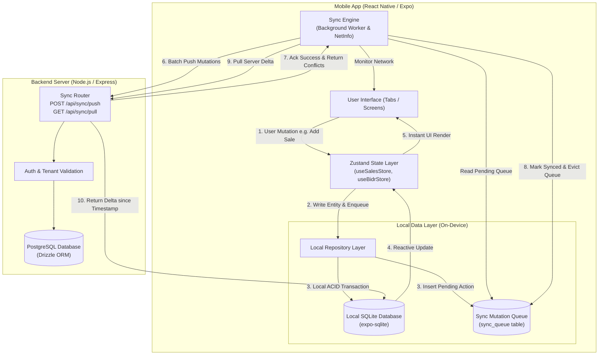

# Offline-First Architecture & Sync Plan — NetWorth Ethiopia

## 1. Executive Summary

NetWorth Ethiopia is a mission-critical financial management and bookkeeping application tailored for Ethiopian micro, small, and medium businesses (MSMEs). A core operational reality in Ethiopia is intermittent connectivity: cellular network fluctuations, power outages affecting Wi-Fi routers, and travel between regional trading centers.

Currently, NetWorth requires an active network connection for all mutations (creating sales, recording expenses, issuing customer credit/dube, settling debts) and queries. If connectivity is lost, the application fails, blocking shopkeepers from recording transactions at the point of sale.

This document outlines the **Offline-First Synchronization Architecture**. Under this architecture:
1. **100% Offline Capability**: All reads, writes, searches, and dashboard metrics work instantly without any active network connection.
2. **Local Relational Database (SQLite via `expo-sqlite`)**: High-performance, ACID-compliant local storage on the Android device.
3. **Outbox Mutation Queue (`sync_queue`)**: Offline actions are queued locally in transactional order with client-generated UUIDs.
4. **Bidirectional Delta Synchronization**: When connectivity resumes, queued mutations are pushed upstream with idempotency guarantees, and remote updates are pulled downstream.
5. **Zero UI Blocking**: The user interface is decoupled from network latency, eliminating loading spinners for everyday point-of-sale actions.

---

## 2. Master System Architecture

The diagram below illustrates the end-to-end data flow between the Android client and the backend server.

---

## 3. Directory Navigation

The offline sync documentation is structured into the following specialized modules:

| Document | Focus & Content |
| :--- | :--- |
| **[1. SQLite Evaluation](file:///home/eaglex/Documents/insa-ctc/FinalProject/docs/offline-sync/sqlite-evaluation.md)** | Comprehensive comparison of `expo-sqlite` vs MMKV, AsyncStorage, WatermelonDB, and Realm across feasibility, performance, memory, code quality, and Android compatibility. |
| **[2. Sync Architecture & Protocol](file:///home/eaglex/Documents/insa-ctc/FinalProject/docs/offline-sync/sync-architecture-and-protocol.md)** | Database schemas, mutation outbox queue design, push/pull delta sync protocol, client UUID generation, and conflict resolution rules. |
| **[3. Implementation Roadmap](file:///home/eaglex/Documents/insa-ctc/FinalProject/docs/offline-sync/implementation-roadmap.md)** | Phased 5-stage implementation plan, backend API specifications, frontend repository structure, testing matrix, and deployment checklist. |

---

## 4. Key Architectural Decisions at a Glance

1. **Local Database Engine**: **`expo-sqlite`**
   - *Rationale*: Native C performance, zero third-party native compilation friction in Expo SDK 57, direct support for SQL aggregations (revenue, dube totals offline), and direct architectural alignment with backend relational models.
2. **Identifier Generation**: **Client-side UUIDv4 (`crypto.randomUUID()`)**
   - *Rationale*: Eliminates temporary IDs and complex foreign key remapping. Every sale, expense, and debt has its permanent production UUID at the moment of creation offline.
3. **Queue Strategy**: **Persistent Transactional Outbox**
   - *Rationale*: Mutations are saved in SQLite within the same ACID transaction as the business entity. Even if the phone battery dies or the OS terminates the app, zero data is lost.
4. **Sync Triggering**: **Multi-trigger Hybrid**
   - *Rationale*: Network reconnect listener (`expo-network`), application foregrounding (`AppState`), periodic timer (every 3 minutes when online), and manual pull-to-refresh.
5. **Conflict Resolution**:
   - **Sales & Expenses**: Immutable append-only ledger entries. Duplicate prevention through idempotency keys.
   - **Dube (Debt) Status**: Last-Write-Wins with timestamp verification and state-transition safety (e.g. once marked settled, subsequent offline edits are flagged for reconciliation).
