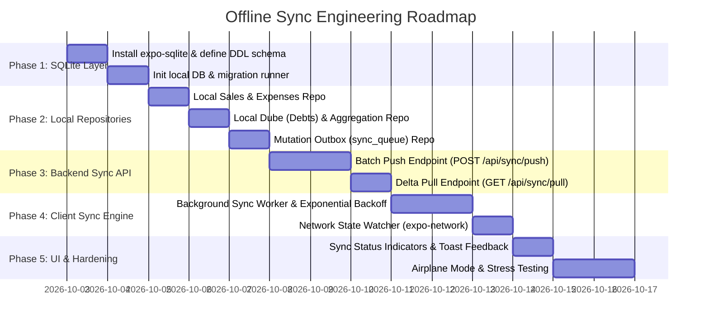

# Offline Sync Implementation Roadmap & Engineering Plan

## 1. Overview & Phased Strategy

The offline synchronization capability is engineered in **5 distinct phases**. Each phase is modular, testable independently, and avoids destabilizing the existing production codebase.



---

## 2. Phase-by-Phase Execution Plan

### Phase 1: Local SQLite Foundation (`mobile/`)
**Objective**: Establish a robust, high-performance, WAL-enabled local database on Android.

1. **Package Installation**:
   ```bash
   cd mobile && npx expo install expo-sqlite
   ```
2. **Directory Structure**:
   ```text
   mobile/src/
   ├── db/
   │   ├── client.ts             # SQLite connection instance with WAL & Foreign Keys
   │   ├── schema.ts             # SQL table DDLs and indexing scripts
   │   ├── migrations.ts         # User version tracking and automated schema upgrades
   ```
3. **Connection Factory (`mobile/src/db/client.ts`)**:
   - Opens `networth.db` asynchronously.
   - Executes PRAGMAs:
     - `PRAGMA journal_mode = WAL;`
     - `PRAGMA foreign_keys = ON;`
     - `PRAGMA synchronous = NORMAL;`

---

### Phase 2: Local Repository Pattern & Store Integration
**Objective**: Decouple the UI from direct HTTP requests. All UI reads and writes go through the local repository.

1. **New Repository Modules**:
   - `mobile/src/repositories/local-sales.repo.ts`:
     - `insertSaleAtomic(sale, mutationPayload)`
     - `getSalesByBranch(businessId, branchId)`
     - `getTodayRevenueMetric(businessId)`
   - `mobile/src/repositories/local-expenses.repo.ts`:
     - `insertExpenseAtomic(expense, mutationPayload)`
     - `getExpensesByBranch(businessId, branchId)`
   - `mobile/src/repositories/local-bidr.repo.ts`:
     - `insertDebtAtomic(debt, mutationPayload)`
     - `settleDebtAtomic(debtId, paymentData)`
     - `getDebtSummaryMetric(businessId, branchId)`
   - `mobile/src/repositories/sync-queue.repo.ts`:
     - `getPendingMutations(limit)`
     - `markMutationsProcessed(mutationIds)`
     - `incrementRetry(mutationId, errorMsg)`
2. **Store Refactoring (`useSalesStore` & `useBidrStore`)**:
   - Update actions (`addSale`, `addExpense`, `create`, `settle`, `update`) to write to local repositories first.
   - The UI reflects the changes instantly (0ms latency).
   - Enqueues background sync event.

---

### Phase 3: Backend Sync Endpoints (`backend/`)
**Objective**: Provide high-throughput, atomic batch synchronization endpoints.

1. **New Backend Routes**:
   - `backend/src/routes/sync.routes.ts`:
     - `POST /api/sync/push`
     - `GET /api/sync/pull`
2. **Push Handler Logic (`POST /api/sync/push`)**:
   - Accepts an array of mutations within a PostgreSQL database transaction (`db.transaction(...)`).
   - For each mutation:
     - Checks if `mutation_id` was already processed (Idempotency table).
     - If new: executes the operation (`INSERT sale`, `UPDATE status = 'settled'`).
   - Returns `{ processedMutationIds: [...] }`.
3. **Pull Handler Logic (`GET /api/sync/pull`)**:
   - Accepts `businessId` and `since` (timestamp).
   - Queries `sale`, `expense`, `branch` where `updatedAt > since`.
   - Returns delta bundle and current `serverTimestamp`.

---

### Phase 4: Client Sync Engine & Network Automation
**Objective**: Automatically synchronize local data with the backend whenever connectivity is available.

1. **Sync Engine Service (`mobile/src/service/sync-engine.ts`)**:
   - Single-flight lock (prevents concurrent sync processes).
   - Step 1: Push pending mutations from `sync_queue`.
   - Step 2: On successful push, delete acknowledged items from `sync_queue` and update `local_sale.sync_status = 'synced'`.
   - Step 3: Pull server delta using `last_pulled_at`.
   - Step 4: Upsert incoming server records into local SQLite.
   - Step 5: Update `last_pulled_at` in `sync_metadata`.
   - Step 6: Notify Zustand stores to refresh UI.
2. **Network Watcher Hook (`mobile/src/hooks/use-network-sync.ts`)**:
   - Uses `expo-network` to detect network transitions.
   - Automatically kicks off `syncEngine.sync()` when moving from offline to online.
   - Listens to React Native `AppState` to sync when user reopens the app.

---

### Phase 5: UI Status Indicators & Hardening
**Objective**: Provide transparent user feedback and test edge cases.

1. **UI Components**:
   - Subtle "Offline Mode" badge on the top header when disconnected.
   - Tiny sync indicator ("Syncing 3 pending items..." / "All data synced") in the hamburger header.
2. **Resilience & Edge-Case Defenses**:
   - Exponential backoff: If backend returns 500 or times out, retry delays scale: 2s, 4s, 8s, 16s, max 60s.
   - Poison Pill Isolation: If a malformed mutation fails 5 times, it is quarantined to `sync_errors` to avoid blocking newer mutations.

---

## 3. Detailed Verification & Test Matrix

| Test Scenario | Test Steps | Expected Result | Pass Criteria |
| :--- | :--- | :--- | :--- |
| **1. 100% Offline Sale Creation** | 1. Enable Airplane mode on Android.<br>2. Record 3 cash sales and 1 Telebirr sale.<br>3. Verify Sales Tab list and Dashboard metrics. | Sales appear instantly in list. Today's revenue updates immediately. `sync_status` is `pending_create`. | No spinners, no errors, instant UI render. |
| **2. 100% Offline Debt & Settlement** | 1. Keep Airplane mode on.<br>2. Create a new Dube debt of 1,200 ETB for "Abebe".<br>3. Settle an existing debt of 500 ETB. | Dube shows in Bidr notebook. Registered Dube metric reflects new debt and settlement. | Bidr summary updates offline correctly. |
| **3. Reconnect & Auto-Replication** | 1. Disable Airplane mode (connect to Wi-Fi/4G).<br>2. Wait for auto-sync trigger. | Sync engine pushes 5 mutations to backend. Backend PostgreSQL receives all records. Local `sync_queue` is cleared. | Backend DB matches local phone DB with exact UUIDs. |
| **4. App Process Termination** | 1. While offline, record a sale.<br>2. Force-close the app from Android recent apps.<br>3. Reopen the app. | The offline sale persists in SQLite and `sync_queue`. | Zero data loss across process reboots. |
| **5. Concurrent Multi-Device Sync** | 1. Device A creates a sale offline.<br>2. Device B creates an expense online.<br>3. Device A connects to internet. | Device A pushes sale and pulls Device B's expense. Both devices now share identical state. | Bi-directional delta consistency verified. |
