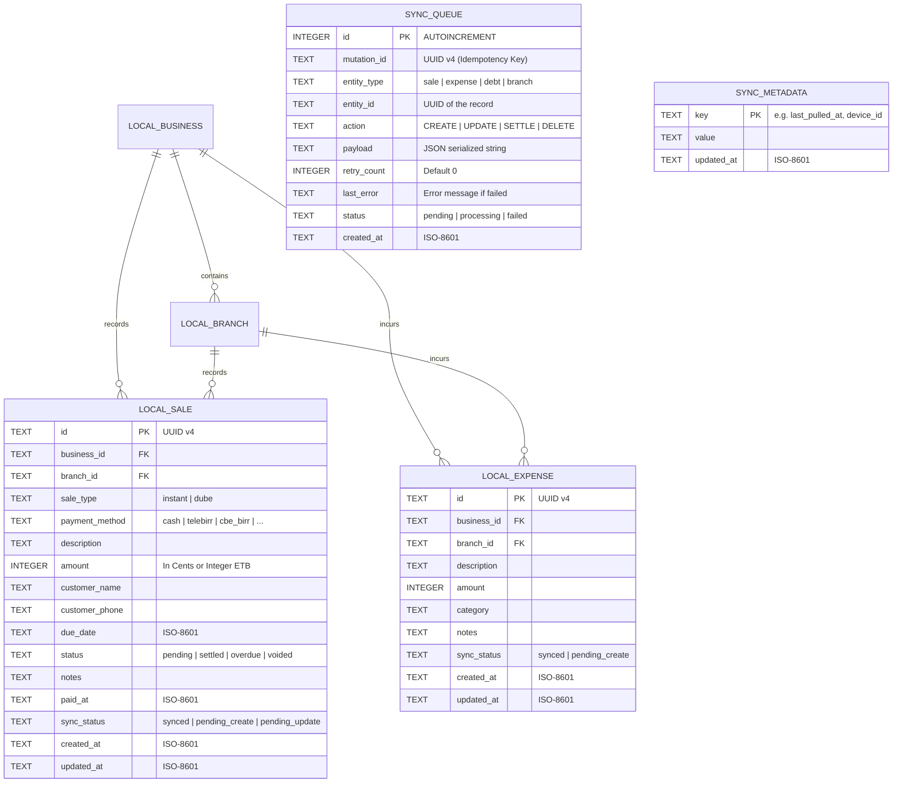
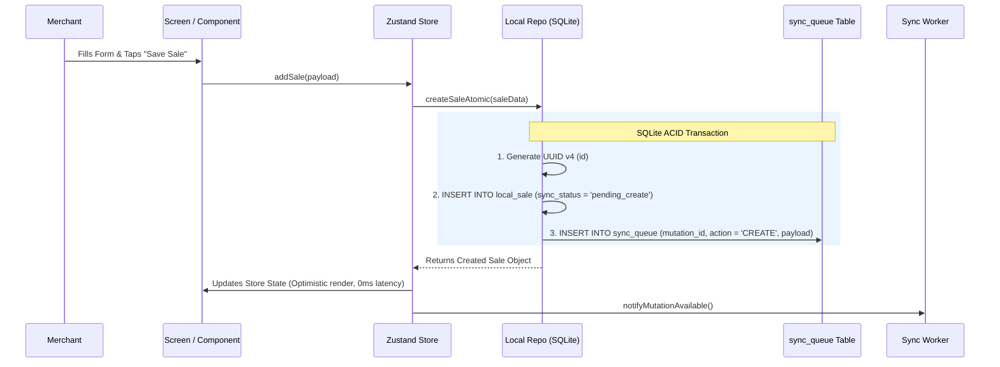
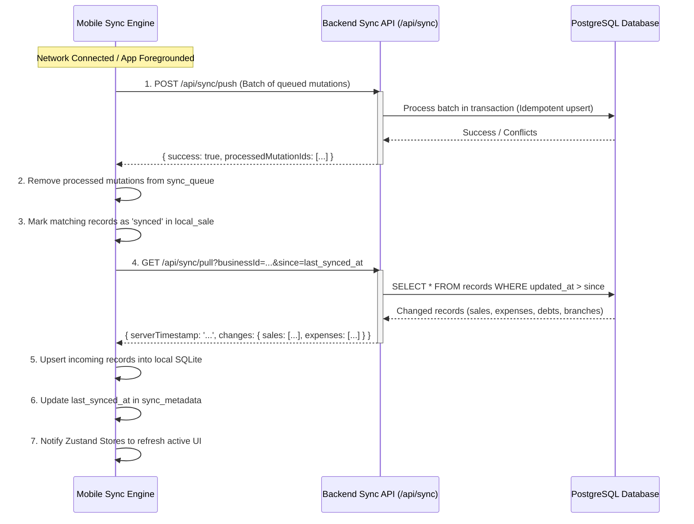

# Sync Architecture & Bidirectional Protocol

## 1. System Overview & The Local-First Principle

NetWorth Ethiopia implements a **Local-First Architecture**. Under this model:
- The **local SQLite database is the primary source of truth for the mobile UI**.
- Every screen and Zustand store reads from local SQLite.
- Every user mutation writes to local SQLite first.
- The network is treated as an asynchronous replication channel rather than a blocking prerequisite for operations.

---

## 2. Local Database Schema (`expo-sqlite`)

The local SQLite schema mirrors the PostgreSQL backend schema while adding metadata columns (`sync_status`, `sync_attempt`, `client_updated_at`) to track replication state.



### Table Definitions (DDL)

```sql
-- 1. Local Sales & Dube Table
CREATE TABLE IF NOT EXISTS local_sale (
  id TEXT PRIMARY KEY NOT NULL,
  business_id TEXT NOT NULL,
  branch_id TEXT NOT NULL,
  sale_type TEXT CHECK(sale_type IN ('instant', 'dube')) NOT NULL,
  payment_method TEXT NOT NULL,
  description TEXT NOT NULL,
  amount INTEGER NOT NULL,
  customer_name TEXT,
  customer_phone TEXT,
  due_date TEXT,
  status TEXT CHECK(status IN ('pending', 'settled', 'overdue', 'voided')) NOT NULL,
  notes TEXT,
  paid_at TEXT,
  sync_status TEXT DEFAULT 'pending_create' NOT NULL,
  created_at TEXT NOT NULL,
  updated_at TEXT NOT NULL
);

CREATE INDEX IF NOT EXISTS idx_local_sale_biz ON local_sale(business_id, created_at DESC);
CREATE INDEX IF NOT EXISTS idx_local_sale_branch ON local_sale(branch_id);
CREATE INDEX IF NOT EXISTS idx_local_sale_status ON local_sale(status);
CREATE INDEX IF NOT EXISTS idx_local_sale_type ON local_sale(sale_type);

-- 2. Local Expenses Table
CREATE TABLE IF NOT EXISTS local_expense (
  id TEXT PRIMARY KEY NOT NULL,
  business_id TEXT NOT NULL,
  branch_id TEXT NOT NULL,
  description TEXT NOT NULL,
  amount INTEGER NOT NULL,
  category TEXT NOT NULL,
  notes TEXT,
  sync_status TEXT DEFAULT 'pending_create' NOT NULL,
  created_at TEXT NOT NULL,
  updated_at TEXT NOT NULL
);

CREATE INDEX IF NOT EXISTS idx_local_expense_biz ON local_expense(business_id, created_at DESC);

-- 3. Sync Outbox Queue
CREATE TABLE IF NOT EXISTS sync_queue (
  id INTEGER PRIMARY KEY AUTOINCREMENT,
  mutation_id TEXT UNIQUE NOT NULL,
  entity_type TEXT NOT NULL,
  entity_id TEXT NOT NULL,
  action TEXT NOT NULL,
  payload TEXT NOT NULL,
  retry_count INTEGER DEFAULT 0 NOT NULL,
  last_error TEXT,
  status TEXT DEFAULT 'pending' NOT NULL,
  created_at TEXT NOT NULL
);

CREATE INDEX IF NOT EXISTS idx_sync_queue_pending ON sync_queue(status, id ASC);

-- 4. Sync Metadata (Cursors)
CREATE TABLE IF NOT EXISTS sync_metadata (
  key TEXT PRIMARY KEY NOT NULL,
  value TEXT NOT NULL,
  updated_at TEXT NOT NULL
);
```

---

## 3. The Transactional Outbox Pattern

To ensure that no offline mutation is ever lost, writing to the entity table and the outbox queue occurs within a **single SQLite transaction**.



---

## 4. Client UUID Generation & Idempotency

### Why Client UUIDs?
Historically, systems used auto-incrementing integer IDs or waited for server responses to receive an ID. In an offline-first app, this creates a major bottleneck:
1. An offline sale cannot reference a parent or branch without a valid ID.
2. Temporary IDs require remapping all relational foreign keys when the server assigns permanent IDs upon sync.

**NetWorth Solution**:
Every entity receives an RFC 4122 Version 4 UUID (`crypto.randomUUID()`) generated immediately on the device:
- The client-generated ID is permanent.
- The server stores the record using the client-provided `id`.
- The `mutation_id` in `sync_queue` acts as an **Idempotency Key**. If a network timeout causes the client to push the same mutation twice, the server identifies the duplicate key and returns HTTP 200 without creating a duplicate record.

---

## 5. Bidirectional Sync Protocol (Push & Pull)

The synchronization protocol executes in two phases: **Push (upstream replication)** followed by **Pull (downstream replication)**.



### 5.1 Push API Specification (`POST /api/sync/push`)

**Request Payload**:
```json
{
  "businessId": "biz_8f43c19b",
  "deviceId": "dev_a06_91382",
  "mutations": [
    {
      "mutationId": "mut_e41b9c7e-8512-4217-bfec-123456789abc",
      "entityType": "sale",
      "action": "CREATE",
      "entityId": "sale_71b9c7e-8512-4217-bfec-987654321def",
      "timestamp": "2026-10-02T18:30:00.000Z",
      "payload": {
        "id": "sale_71b9c7e-8512-4217-bfec-987654321def",
        "branchId": "br_4421b01c",
        "saleType": "instant",
        "paymentMethod": "telebirr",
        "description": "Counter items",
        "amount": 450,
        "status": "settled",
        "createdAt": "2026-10-02T18:30:00.000Z"
      }
    },
    {
      "mutationId": "mut_b11c9c7e-9912-4217-bfec-333444555666",
      "entityType": "debt",
      "action": "SETTLE",
      "entityId": "sale_dube_8812b",
      "timestamp": "2026-10-02T19:15:00.000Z",
      "payload": {
        "paymentMethod": "cash",
        "notes": "Full settlement at shop"
      }
    }
  ]
}
```

**Response Payload**:
```json
{
  "status": "success",
  "processedMutationIds": [
    "mut_e41b9c7e-8512-4217-bfec-123456789abc",
    "mut_b11c9c7e-9912-4217-bfec-333444555666"
  ],
  "rejectedMutations": []
}
```

### 5.2 Pull API Specification (`GET /api/sync/pull`)

**Query Parameters**:
- `businessId`: `biz_8f43c19b`
- `since`: ISO timestamp (e.g. `2026-10-02T17:00:00.000Z`). If omitted or null, performs initial hydration.

**Response Payload**:
```json
{
  "serverTimestamp": "2026-10-02T22:15:30.120Z",
  "changes": {
    "sales": [
      {
        "id": "sale_71b9c7e-8512-4217-bfec-987654321def",
        "businessId": "biz_8f43c19b",
        "branchId": "br_4421b01c",
        "saleType": "instant",
        "paymentMethod": "telebirr",
        "description": "Counter items",
        "amount": 450,
        "status": "settled",
        "updatedAt": "2026-10-02T18:30:01.000Z",
        "createdAt": "2026-10-02T18:30:00.000Z"
      }
    ],
    "expenses": [],
    "debts": [],
    "branches": []
  }
}
```

---

## 6. Conflict Resolution Strategy

Conflicts can occur when multiple devices record changes for the same business, or when a debt is modified while offline:

| Entity / Action | Conflict Nature | Resolution Rule | Technical Implementation |
| :--- | :--- | :--- | :--- |
| **Sales (Instant)** | High Volume, Append-Only | **Additive / No Conflict** | Instant sales are financial ledger entries. Each record has a unique UUID. The server accepts all valid new sales idempotently. |
| **Expenses** | Append-Only | **Additive / No Conflict** | Similar to sales, expenses are immutable operational records. |
| **Debt Creation** | Append-Only | **Additive / No Conflict** | Creating a dube creates a new record with a unique UUID. |
| **Debt Settlement** | State Mutation (`pending` -> `settled`) | **Terminal State Wins** | Once a debt is marked `settled` (either on server or client), it remains settled. If two devices settle the same debt offline with different payment methods, the earlier `paid_at` timestamp takes precedence. |
| **Debt Updates (Notes/Due Date)** | State Mutation | **Last-Write-Wins (LWW)** | Compare `payload.updated_at` with server `updated_at`. The higher timestamp overwrites. |
| **Branch / Business Profile** | Master Configuration | **Server Authority** | Branch names, active statuses, and company metadata are authoritative on the server. Pulled changes overwrite local cache. |

---

## 7. Network Monitoring & Trigger Engine

The sync engine is reactive and executes automatically across four distinct lifecycle triggers:

1. **Network Connectivity Transition**:
   - Monitored via `expo-network` (`Network.addNetworkStateListener`).
   - When transitioning from `isConnected: false` to `isConnected: true`, a sync flush is triggered immediately.
2. **Application Lifecycle Resume**:
   - Monitored via React Native `AppState` (`active` state change).
   - Whenever the merchant opens the app or returns from another app (e.g. Telebirr SMS notification), sync pulls latest server changes.
3. **Periodic Heartbeat**:
   - When the app is in the foreground and online, a background timer checks the `sync_queue` every 3 minutes.
4. **Manual User Pull-to-Refresh**:
   - Available on Dashboard, Sales, and Bidr (Dube) screens.
