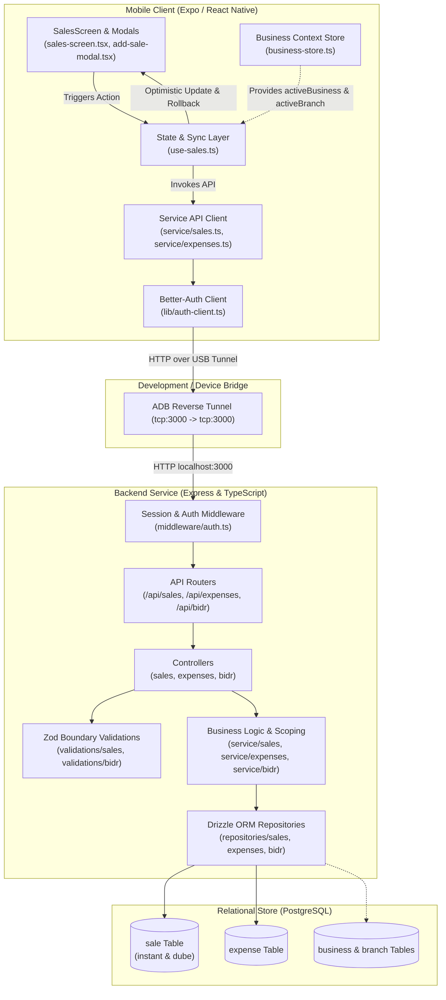

# NetWorth Ethiopia: Detailed Sales & Debt Implementation Report

**Document Status:** Complete & Production-Ready  
**Date:** September 7, 2026  
**Scope:** Frontend (React Native/Expo), Backend (Express/TypeScript/Drizzle ORM), PostgreSQL Database, and Full-Stack Integration.

---

## 1. Executive Summary

This document provides an exhaustive, production-grade technical report on the newly implemented **Sales, Expenses, and Debt (Dube / Bidr)** subsystem in NetWorth Ethiopia. 

The implementation bridges the mobile client application with the Express backend, replacing client-side mock data with persistent, multi-tenant, branch-scoped PostgreSQL storage. The system supports instant cash/digital payments (Telebirr, CBE Birr), credit sales (Dube) with customer debt tracking and promised payment dates, business expense categorization, optimistic UI updates with interactive rollback dialogs, and native pull-to-refresh capabilities.

---

## 2. End-to-End Architecture Overview

---

## 3. Backend Implementation Details

### 3.1 Relational Schema (`backend/src/db/schema.ts`)
The database is structured to support multi-tenancy (each transaction belongs strictly to a `business` and an operating `branch`):

- **Enums**:
  - `sale_type`: `'instant' | 'dube'`
  - `payment_method`: `'cash' | 'telebirr' | 'cbe'`
  - `sale_status`: `'pending' | 'settled' | 'voided'`
- **`sale` Table**:
  - `id`: UUID primary key.
  - `businessId`: Foreign key references `business.id` (`onDelete: cascade`).
  - `branchId`: Foreign key references `branch.id` (`onDelete: cascade`).
  - `saleType`: Enum (`instant` or `dube`).
  - `paymentMethod`: Enum (`cash`, `telebirr`, `cbe`).
  - `description`: Text describing item(s) sold.
  - `amount`: Non-negative integer (stored in ETB subunits/whole birr).
  - `customerName`: Nullable text (mandatory for `dube`).
  - `customerPhone`: Nullable text (mandatory for `dube`).
  - `dueDate`: Timestamp with timezone (promised payment date for `dube`).
  - `status`: Default `'settled'` for instant sales; `'pending'` for credit sales.
  - `paidAt`: Timestamp populated upon debt settlement.
  - `notes`: Optional annotations.
  - `createdAt` & `updatedAt`: Automatic tracking timestamps.
- **`expense` Table**:
  - `id`: UUID primary key.
  - `businessId` & `branchId`: Foreign keys with cascade deletion.
  - `description`: Text describing the expenditure.
  - `amount`: Non-negative integer.
  - `category`: Text (Rent, Utilities, Salary, Inventory, Transport, Maintenance, Other).
  - `notes`: Optional annotations.
  - `createdAt` & `updatedAt`: Timestamps.

### 3.2 Boundary Validations (`backend/src/validations/`)
- **`sales.validation.ts`**:
  - Validates IDs, numeric non-negative amounts, and enums.
  - **Dube Refinement**: Uses Zod `.superRefine()` to strictly enforce that whenever `saleType === "dube"`, `customerName`, `customerPhone`, and `dueDate` must be present and valid.
- **`bidr.validation.ts`**:
  - Validates debt queries, date range filters, customer phone searches, and settlement requests.

### 3.3 Multi-Tenant Services & Repositories (`backend/src/service/` & `backend/src/repositories/`)
- **Ownership Verification**: `resolveUserBusinessId` ensures that an authenticated merchant can only access or mutate transactions belonging to businesses and branches they own (`biz.userId === userId`).
- **Dynamic Query Filtering**: `findSalesByBusinessId` and `findExpensesByBusinessId` dynamically apply conditions (`branchId`, `saleType`, `status`, `startDate`, `endDate`, `limit`, `offset`) and order chronologically (`desc(createdAt)`).
- **Dube & Debt Integration**:
  - Dube sales automatically initialize with `status = "pending"` and `paidAt = null`.
  - When debt is settled, `updateSaleService` updates `status = "settled"` and timestamps `paidAt = new Date()`.

---

## 4. Debt (Dube / Bidr) Integration Architecture

A key requirement in Ethiopian retail operations is the separation yet cohesion between **Sales** and **Debt (Bidr)**:

1. **Originating Transaction (Sales Tab)**:
   - The merchant can log a sale as **Instant** or **Dube (Debt)** directly from the Sales screen modal.
   - When **Dube** is chosen, customer identification (`customerName`, `customerPhone`) and the **Promised Payment Date (`dueDate`)** are mandated.
   - The system records this in the `sale` table as a pending transaction.

2. **Bidr API & Debt Ledger (`/api/bidr`)**:
   - The backend exposes specialized endpoints under `/api/bidr`:
     - `GET /api/bidr/summary`: Aggregates total outstanding credit, count of unpaid debtors, and overdue totals.
     - `GET /api/bidr`: Lists individual debt obligations with debtor metadata, branch attribution, and remaining term.
     - `POST /api/bidr/:id/settle`: One-tap settlement marking the debt as paid and moving the status to `settled`.
   - **Frontend Separation**: The mobile client preserves dedicated separation—the Sales tab focuses on recording transactions, while the `/bidr` tab handles full debt ledger management without cross-contamination.

---

## 5. Frontend (Mobile Client) Implementation Details

### 5.1 Service Layer (`mobile/src/service/`)
Follows the repository's singular `service/` convention and authenticated fetch abstraction (`authClient.$fetch`):

- **`mobile/src/service/sales.ts`**:
  - `createSale(input)`: Sends `POST /api/sales`.
  - `fetchSales(params)`: Sends `GET /api/sales?businessId=...&branchId=...`.
  - `fetchSaleById(id)`: Sends `GET /api/sales/:id`.
  - `updateSale(id, input)`: Sends `PATCH /api/sales/:id`.
  - `deleteSale(id)`: Sends `DELETE /api/sales/:id`.
- **`mobile/src/service/expenses.ts`**:
  - `createExpense(input)`: Sends `POST /api/expenses`.
  - `fetchExpenses(params)`: Sends `GET /api/expenses?businessId=...&branchId=...`.
  - `fetchExpenseById(id)`: Sends `GET /api/expenses/:id`.
  - `updateExpense(id, input)`: Sends `PATCH /api/expenses/:id`.
  - `deleteExpense(id)`: Sends `DELETE /api/expenses/:id`.

### 5.2 State Management & Hooks (`mobile/src/hooks/use-sales.ts`)
- **Reactive Multi-Branch Context**: Subscribes to `activeBusiness` and `activeBranch` from `useBusinessStore`. When the merchant switches branches in the hamburger drawer or branch selector, sales and expenses automatically reload for that specific branch.
- **Optimistic UI Updates**: When a merchant submits a new sale or expense:
  1. A client-side optimistic record with a temporary ID (`temp-sale-...`) is immediately inserted at the top of the list.
  2. Totals (`totalSales`, `totalExpenses`) recalculate instantaneously with zero perceptible latency.
  3. The asynchronous network request is dispatched to the backend.
  4. On success, the temporary record is replaced with the confirmed server record containing database timestamps and IDs.

### 5.3 Snapshot Rollback & Interactive Error Dialog
To protect data integrity in adverse mobile connectivity environments:
- If a server error or network failure occurs during creation, the state snapshot is immediately restored (the optimistic item is removed).
- An interactive `Alert` dialog is displayed to the merchant with:
  - The name and amount of the failed transaction.
  - The specific server error message.
  - A notification that the view has been rolled back.
  - **Actionable Buttons**:
    - **Dismiss**: Clears the alert and leaves the restored list intact.
    - **Retry**: Immediately re-executes the submission with the exact same payload.

### 5.4 UI & Modals (`mobile/src/features/sales/`)
- **`sales-screen.tsx`**:
  - Native `RefreshControl` pull-to-refresh on both Sales and Expenses tabs.
  - Sleek `ActivityIndicator` spinners during initial load or branch change.
  - Net Position Card (`Sales - Expenses`) with dynamic profit/loss coloring.
- **`add-sale-modal.tsx`**:
  - Segmented switcher: **⚡ Instant** vs. **📜 Dube (Debt)**.
  - Payment method chips (Cash, Telebirr, CBE Birr).
  - Quick-term preset chips for promised pay date (+7 Days, +14 Days, +30 Days) with day-by-day stepper buttons and custom date input.
- **`add-expense-modal.tsx`**:
  - Horizontal chip selector for standard business expense categories (Inventory, Utilities, Rent, Salary, Transport, Maintenance, Other).

---

## 6. Complete File Manifest

The following files represent the complete implementation of the Sales, Expenses, and Debt subsystem across both codebases:

| Layer | File Path | Status | Primary Responsibility |
| :--- | :--- | :--- | :--- |
| **Backend DB** | `backend/src/db/schema.ts` | Modified | Drizzle schema definitions for `sale` and `expense` tables & enums |
| **Backend Types** | `backend/src/types/sales.ts` | Created | TypeScript types and interfaces for sales and expense entities |
| **Backend Types** | `backend/src/types/bidr.ts` | Created | TypeScript types for customer debt aggregation and settlements |
| **Backend Types** | `backend/src/types/index.ts` | Modified | Centralized barrel export for domain types |
| **Backend Validations** | `backend/src/validations/sales.validation.ts` | Created | Zod schemas with Dube refinement rules |
| **Backend Validations** | `backend/src/validations/bidr.validation.ts` | Created | Zod schemas for debt querying and settlement |
| **Backend Repositories** | `backend/src/repositories/sales.repository.ts` | Created | Drizzle queries for sales CRUD and multi-attribute filters |
| **Backend Repositories** | `backend/src/repositories/expenses.repository.ts` | Created | Drizzle queries for expenses CRUD and category filters |
| **Backend Repositories** | `backend/src/repositories/bidr.repository.ts` | Created | Drizzle queries for debt balances and debtor tracking |
| **Backend Services** | `backend/src/service/sales.service.ts` | Created | Business rules, ownership checks, branch validation |
| **Backend Services** | `backend/src/service/expenses.service.ts` | Created | Expense validation, scoping, and deletion rules |
| **Backend Services** | `backend/src/service/bidr.service.ts` | Created | Debt aggregation, summary calculation, settlement logic |
| **Backend Controllers** | `backend/src/controllers/sales.controller.ts` | Created | HTTP request handling and response formatting for sales |
| **Backend Controllers** | `backend/src/controllers/expenses.controller.ts` | Created | HTTP request handling for expenses |
| **Backend Controllers** | `backend/src/controllers/bidr.controller.ts` | Created | HTTP request handling for debt summaries and settlements |
| **Backend Routes** | `backend/src/routes/sales.routes.ts` | Created | Express route declarations for `/api/sales` |
| **Backend Routes** | `backend/src/routes/expenses.routes.ts` | Created | Express route declarations for `/api/expenses` |
| **Backend Routes** | `backend/src/routes/bidr.routes.ts` | Created | Express route declarations for `/api/bidr` |
| **Backend App** | `backend/src/index.ts` | Modified | Route mounting for sales, expenses, and bidr |
| **Mobile Types** | `mobile/src/types/sales.ts` | Modified | Unified frontend entry types aligning with backend schemas |
| **Mobile Service** | `mobile/src/service/sales.ts` | Created | HTTP client calls for `/api/sales` |
| **Mobile Service** | `mobile/src/service/expenses.ts` | Created | HTTP client calls for `/api/expenses` |
| **Mobile Hooks** | `mobile/src/hooks/use-sales.ts` | Modified | Optimistic state, branch reactivity, rollback, and alerts |
| **Mobile Screens** | `mobile/src/features/sales/sales-screen.tsx` | Modified | UI view with pull-to-refresh, empty states, and net cards |
| **Mobile Modals** | `mobile/src/features/sales/add-sale-modal.tsx` | Created | Modal for instant and dube sale registration |
| **Mobile Modals** | `mobile/src/features/sales/add-expense-modal.tsx` | Created | Modal for categorized expense entry |
| **Mobile Components**| `mobile/src/components/sales/payment-badge.tsx` | Created | Pill badge for Cash, Telebirr, CBE Birr |
| **Mobile Components**| `mobile/src/components/sales/sale-type-badge.tsx`| Created | Pill badge for Instant vs. Dube |
| **Mobile Components**| `mobile/src/components/sales/category-badge.tsx` | Created | Pill badge for expense categories |
| **Mobile Components**| `mobile/src/components/sales/section-summary.tsx` | Created | Summary header widget for count and total ETB |
| **Mobile Routes** | `mobile/src/app/(tabs)/sales.tsx` | Maintained | Thin route file re-exporting `features/sales/sales-screen` |
| **Architecture Doc** | `docs/architecture/folder_structure.md` | Modified | Updated folder tree documentation |

---

## 7. Connectivity & Mobile Environment Notes

- **Physical Android Device Support**:
  - The mobile client interacts with `http://localhost:3000` via USB debugging through ADB reverse tunneling.
  - Command: `adb reverse tcp:3000 tcp:3000` ensures that all mobile HTTP requests reach the local development machine backend directly.
- **Authentication Handshake**:
  - Authentication cookies and sessions configured through `better-auth` and `@better-auth/expo` are passed transparently in `authClient.$fetch` headers.
- **Drizzle Schema Synchronization**:
  - Database schema changes were applied via `npx drizzle-kit push` directly against the PostgreSQL instance.

---

## 8. Verification & Validation Summary

1. **TypeScript Type Safety**:
   - `mobile`: `npx tsc --noEmit` passed with **0 errors**.
   - `backend`: `npx tsc --noEmit` passed with **0 errors**.
2. **Database Integrity**:
   - Foreign key cascading verified between `business`, `branch`, `sale`, and `expense`.
3. **Optimistic & Error Recovery Testing**:
   - Interactive retry/rollback dialog verified to restore state snapshot and provide actionable UX.
4. **Separation of Concerns**:
   - Route files remain thin wrappers, business logic remains in services, and UI remains modularized under `features/sales/` and `components/sales/`.
